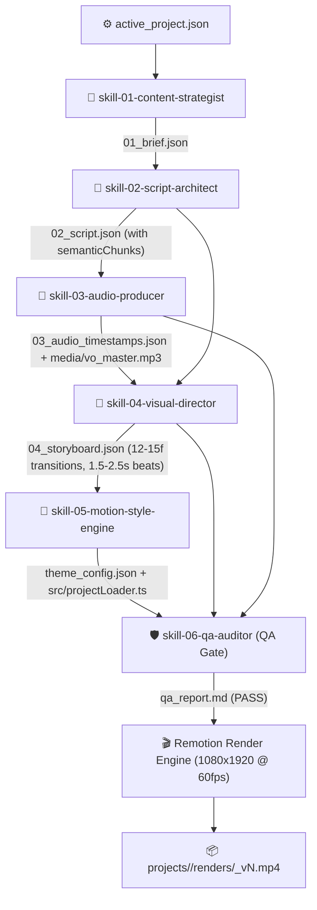

# Technical Architecture, Multi-Project System & Checkpoint Revision Guide
**Project:** Automated Instagram Reels Production System (`Video-as-Code`)  
**Supported Archetypes:** Archetype A (*Editorial 2D Explainer*), Archetype B (*Dark Developer & Engineering Telemetry UI*), Archetype C (*Blueprint & Pop-Up Hybrid*)  
**Canvas Specification:** `1080x1920` (9:16 Vertical), `60 FPS`, H.264 `.mp4`

---

## 1. Struktur Direktori Multi-Project (Mesin vs Konten)

Arsitektur proyek memisahkan **Mesin Produksi (Engine)** dari **Konten Video (Projects)** agar *scalable*, mudah dipelihara, dan mendukung produksi massal (*batch production*) maupun revisi parsial (*checkpoint*):

```text
motion-graphic/
├── active_project.json                 # Saklar utama penentu proyek aktif (misal: "002_drone-pitch-physics")
├── src/                                # [MESIN] Komponen Remotion & Dynamic Project Loader (src/projectLoader.ts)
├── scripts/                            # [MESIN] CLI Automation (tts_engine.py, qa_auditor.py)
├── .agent/skills/                      # [MESIN] 6 Core Skills (skill-01 s/d skill-06)
├── assets/global/                      # [MESIN] Aset audio/visual global lintas-proyek
│   ├── sfx/                            # SFX standar (pop, whoosh, tick, riser, highlight)
│   └── bgm/                            # BGM ambient auto-ducked
└── projects/                           # [KONTEN] Setiap video berdiri sendiri (Self-Contained)
    ├── _template/                      # Template kosong untuk inisialisasi proyek baru
    ├── 001_hiu-lebih-tua-dari-pohon/   # Proyek 001 (Archetype A - Smoke Test)
    └── 002_drone-pitch-physics/        # Proyek 002 (Archetype B - Deep-Dive Drone Physics)
        ├── project.meta.json           # Metadata (ID, slug, judul, archetype, status, versi, tanggal)
        ├── 01_brief.json               # Output Skill-01 (Persona, Hook 3s, Open Loops 15-20s, Payoff)
        ├── 02_script.json              # Output Skill-02 (Naskah VO, Semantic Chunks, Display Text)
        ├── 03_audio_timestamps.json    # Output Skill-03 (Word Timestamps, Phrase-Aware Caption Chunks)
        ├── 04_storyboard.json          # Output Skill-04 (Timeline Frame, CameraRig, Visual Beats 1.5-2.5s)
        ├── theme_config.json           # Output Skill-05 (Palet Warna, Font, Parameter Spring Sat-Set)
        ├── qa_report.md                # Output Skill-06 (Laporan Audit Safe Zone, Sync, & Chunking)
        ├── media/                      # File vo_master.mp3 & aset 2D/3D khusus proyek ini
        └── renders/                    # Hasil render berversi (002_drone-pitch-physics_v1.mp4, _v2.mp4)
```

---

## 2. Alur Produksi 6 Core Skills (Decoupled & QA-Gated)



---

## 3. Aturan Checkpoint Revision (Revisi Parsial Tanpa Ulang Dari Nol)

Karena setiap tahap terhubung melalui kontrak file JSON di dalam `projects/<activeProject>/`, revisi cukup dijalankan dari titik (*checkpoint*) yang berubah:

| Skenario Revisi | File Checkpoint yang Diubah | Langkah Eksekusi (Tanpa Mengulang Tahap Sebelumnya) |
| :--- | :--- | :--- |
| **1. Ganti Gaya Visual / Warna / Font / Kecepatan Spring** | `theme_config.json` *(Skill-05)* | **Tidak perlu** ulang riset, naskah, atau TTS VO.<br>1. Edit `projects/<slug>/theme_config.json`<br>2. Jalankan `python scripts/qa_auditor.py`<br>3. Render langsung ke `renders/<slug>_vN.mp4`. |
| **2. Revisi Layout Visual / Kamera / Pacing Storyboard** | `04_storyboard.json` *(Skill-04)* | **Tidak perlu** generate ulang audio VO.<br>1. Edit `projects/<slug>/04_storyboard.json` (pastikan jumlah `durationFrames` tetap sama dengan `03_audio_timestamps.json`)<br>2. Jalankan `python scripts/qa_auditor.py`<br>3. Render ulang ke `renders/<slug>_vN.mp4`. |
| **3. Revisi Narasi VO / Pemenggalan Caption** | `02_script.json` *(Skill-02)* | **Tidak perlu** ulang `01_brief.json`.<br>1. Edit `voText` atau `semanticChunks` di `projects/<slug>/02_script.json`<br>2. Jalankan `python scripts/tts_engine.py`<br>3. Sesuaikan `durationFrames` per-scene di `04_storyboard.json` dengan `sceneTimings` baru<br>4. Jalankan `python scripts/qa_auditor.py` -> Render. |
| **4. Pindah Proyek Aktif** | `active_project.json` | Ubah `"activeProject"` di `active_project.json` (atau gunakan flag `--project <slug>` pada CLI). Seluruh script Python dan komponen Remotion otomatis beralih ke proyek tersebut. |

---

## 4. Standar Kualitas Upgrade v2 (Archetype B & Global Engine)

1. **Storytelling & Retensi (`skill-01` & `skill-02`):**
   - Hook 3 detik pertama langsung memukul paradoks utama.
   - *Pattern Interrupt / Open Loop* di setiap `15–20 detik` untuk mencegah *drop-off*.
   - *Payoff / Plot Twist* kuat di scene penutup.
2. **Smooth Voice Over & Dual-Engine TTS (`skill-03` / `scripts/tts_engine.py`):**
   - Mendukung `edge-tts` dengan `boundary="WordBoundary"`, pengaturan `--voice`, `--rate`, `--pitch`, pemangkasan jeda mati `>280ms` via FFmpeg, serta *Broadcast Vocal EQ & Compression*.
   - Mendukung **ElevenLabs Pro Adapter** (`/v1/text-to-speech/{voice_id}/with-timestamps`) secara otomatis apabila `ELEVENLABS_API_KEY` diisi di `.env`.
3. **Phrase-Aware Semantic Caption Chunking (`<WordSyncCaption />`):**
   - Mengelompokkan subtitle ke dalam `captionChunks` berisi **2–5 kata** yang utuh secara klausa/makna.
   - Mencegah pemotongan kata depan/preposisi menggantung (tidak ada lagi kasus *"drone menukik"* lalu terputus sebelum *"ke depan"*).
4. **Pacing Animasi "Sat-Set" (`skill-04` & `skill-05`):**
   - Durasi transisi antar-scene dipangkas menjadi **`12–15 frames`** (`0.20s–0.25s` @ 60fps).
   - *Spring physics* dipercepat (`stiffness: 280–310`, `damping: 22`, `mass: 0.65`) agar responsif dengan *overshoot* minimal.
   - Setiap **`1.5–2.5 detik` (`90–150 frames`)** terdapat *visual beat* baru (staggered callout, telemetry pulse, atau perubahan state diagram).
