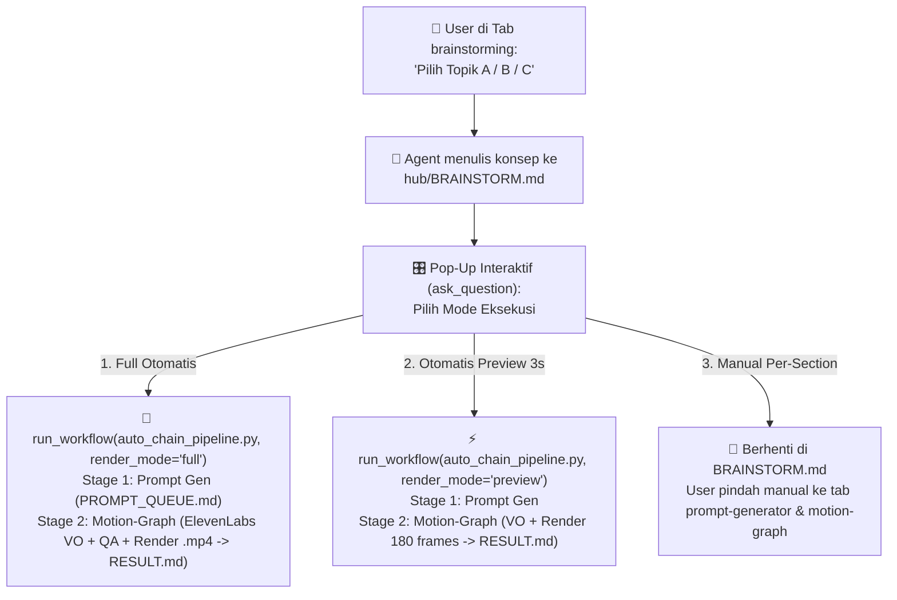

# 🧠 AUTOMATION & MULTI-AGENT BLUEPRINT (`motion-graphic`)

- **Terakhir Diperbarui:** `2026-11-26 07:31 WIB`
- **Workspace Utama:** `C:\Users\LENOVO\Documents\ai-playground\motion-graphic`
- **Folder Komunikasi Antar-Chat (Local Hub):** `C:\Users\LENOVO\Documents\ai-playground\motion-graphic\hub\`

---

## 1. Fitur Utama Baru: Pop-Up Pilihan "Full Otomatis (Auto-Chain)" vs "Manual Per-Section"

Sekarang kamu **tidak perlu lagi pindah-pindah tab secara manual** kalau sedang ingin eksekusi lurus dari ide sampai jadi video `.mp4`!

### Cara Kerjanya:
1. Di tab **`brainstorming`**, kamu minta ide topik (A, B, C).
2. Saat kamu bilang **"Pilih topik B"**, agent `brainstorming` langsung menulis konsep lengkapnya ke `hub/BRAINSTORM.md` DAN **otomatis memunculkan Pop-Up Pilihan (`ask_question`)** di layar chat kamu:
   - **`(Recommended) Full Otomatis — Langsung jalankan Prompt Generator + Motion-Graph (VO ElevenLabs + Render Full .mp4)`**
   - **`Otomatis Preview 3 Detik — Jalankan Prompt Generator + Motion-Graph (VO ElevenLabs + Render Preview 180 frames)`**
   - **`Manual Per-Section — Berhenti di BRAINSTORM.md (Saya akan instruksikan manual ke tiap tab chat)`**
3. Kalau kamu klik **`Full Otomatis`**, sistem langsung menjalankan **[workflows/auto_chain_pipeline.py](file:///c:/Users/LENOVO/Documents/ai-playground/motion-graphic/workflows/auto_chain_pipeline.py)** yang otomatis mengeksekusi tugas `prompt-generator` (`hub/PROMPT_QUEUE.md`) diikuti tugas `motion-graph` (`build_reel.py` + ElevenLabs VO + QA Gate + Render `.mp4` + laporan `hub/RESULT.md`) tanpa kamu perlu ngetik atau pindah tab sama sekali!

---

## 2. Daftar Workflow Orkestrator (`workflows/`)

| File Workflow | Fungsi Utama |
| :--- | :--- |
| **[workflows/auto_chain_pipeline.py](file:///c:/Users/LENOVO/Documents/ai-playground/motion-graphic/workflows/auto_chain_pipeline.py)** | Estafet otomatis **Stage 1 (`Prompt Generator`) $\rightarrow$ Stage 2 (`Motion-Graph Executor & Render`)** yang dipicu dari pop-up `ask_question`. |
| **[workflows/parallel_audit_workflow.py](file:///c:/Users/LENOVO/Documents/ai-playground/motion-graphic/workflows/parallel_audit_workflow.py)** | Mengerahkan 3 Sub-Agent Critic secara paralel (`parallel()`) untuk mengaudit Story, Audio/Caption Sync, dan Visual Pacing ke `hub/BRAINSTORM.md`. |
| **[workflows/produce_reel_workflow.py](file:///c:/Users/LENOVO/Documents/ai-playground/motion-graphic/workflows/produce_reel_workflow.py)** | Pipeline produksi per-fase dengan dukungan *Checkpoint Revision* (`full`, `script`, `visual`, `theme`). |
| **[workflows/overnight_style_learner.py](file:///c:/Users/LENOVO/Documents/ai-playground/motion-graphic/workflows/overnight_style_learner.py)** | Mesin pembelajar style motion grafis otomatis (`hub/STYLE_LAB.md` $\rightarrow$ komponen Remotion `src/components/`). |
