# 🧠 AUTOMATION & MULTI-AGENT BLUEPRINT (`motion-graphic`)

- **Terakhir Diperbarui:** `2026-11-25 22:49 WIB`
- **Workspace Utama:** `C:\Users\LENOVO\Documents\ai-playground\motion-graphic`
- **Folder Komunikasi Antar-Chat (Local Hub):** `C:\Users\LENOVO\Documents\ai-playground\motion-graphic\hub\`

Dokumen ini dihasilkan dari **Chat Arsitektur & Otomasi (`f82744d1`)** sebagai panduan utama cara kerja mesin produksi video otomatis (`Video-as-Code`) serta cara memaksimalkan kolaborasi antar-chat dan *Multi-Agent / Subagent* di Antigravity secara 100% lokal.

---

## 1. Arsitektur 3 Lapis Sistem `motion-graphic`

### A. Lapis 1: Mesin vs Konten (Multi-Project & Checkpoint System)
- **Saklar Proyek Aktif (`active_project.json`):** Menentukan video mana yang sedang dikerjakan (saat ini: `"002_drone-pitch-physics"`).
- **Folder Konten (`projects/<NNN_slug>/`):** Setiap topik video berdiri sendiri (*self-contained*), berisi kontrak data berurutan:
  1. `project.meta.json` — Metadata proyek & pilihan Archetype.
  2. `01_brief.json` — Hasil riset, fakta angka, persona penonton, Hook 3 detik, Open Loop tiap 15–20s, & Payoff.
  3. `02_script.json` — Naskah VO ramah TTS + `semanticChunks` (pemenggalan 2–5 kata utuh secara makna/klausa).
  4. `03_audio_timestamps.json` + `media/vo_master.mp3` — Audio VO yang sudah dipoles FFmpeg + timestamp per-kata & per-frasa presisi 60fps.
  5. `04_storyboard.json` — Timeline deklaratif Remotion (komponen, koordinat X/Y, kamera parallax, visual beat tiap 1.5–2.5 detik, transisi 12–15 frame).
  6. `theme_config.json` — Token warna, font, dan parameter fisika *spring* "Sat-Set".
  7. `qa_report.md` — Laporan audit otomatis sebelum render.
  8. `renders/` — Output video `.mp4` berversi (`_v1.mp4`, `_v2.mp4`).

### B. Lapis 2: Enam Core Skills (`.agent/skills/skill-01` s/d `skill-06`)
Agent memiliki 6 buku panduan (*Skills*) modular yang hanya dimuat saat dibutuhkan (*Progressive Disclosure*):

```mermaid
flowchart LR
    A["active_project.json"] --> S1["01 Content Strategist"]
    S1 -->|"01_brief.json"| S2["02 Script Architect"]
    S2 -->|"02_script.json"| S3["03 Audio Producer (tts_engine.py)"]
    S3 -->|"03_audio_timestamps.json"| S4["04 Visual Director"]
    S4 -->|"04_storyboard.json"| S5["05 Motion Style Engine"]
    S5 -->|"theme_config.json"| S6["06 QA Auditor (qa_auditor.py)"]
    S6 -->|"PASS"| R["build_reel.py -> Remotion (.mp4)"]
```

### C. Lapis 3: Local Inter-Chat Hub 2-Tingkat (`hub/` + `hub/chats/`)
Seluruh komunikasi antar-chat berjalan 100% lokal di folder `hub/` dengan aturan **Strict Ownership (Kepemilikan Jelas)** agar tidak terjadi tumpuk-menumpuk file:
1. **Tingkat 1 (File Papan Utama Berbasis Peran):**
   - `hub/CHAT_REGISTRY.md` — Buku induk seluruh chat yang pernah dibuka di proyek ini beserta link `conversation://` dan file pribadinya.
   - `hub/RESULT.md` — Hanya ditulis oleh Chat Eksekutor / `scripts/build_reel.py`.
   - `hub/PROMPT_QUEUE.md` — Kotak surat instruksi siap eksekusi.
   - `hub/BRAINSTORM.md` — Rangkuman evaluasi Multi-Agent & backlog ide topik.
   - `hub/AUTOMATION.md` — Blueprint sistem otomasi ini.
2. **Tingkat 2 (Kamar Pribadi Tiap Chat — `hub/chats/chat_<shortId>.md`):**
   - Setiap kali tab Chat baru dibuka, Lifecycle Hook `SessionStart` (`.agent/hooks.json` -> `scripts/hook_session_context.py`) otomatis mendaftarkan chat baru tersebut ke `hub/CHAT_REGISTRY.md` dan membuatkan file kamar pribadinya sendiri di `hub/chats/chat_<shortId>.md`.
   - Dengan demikian, setiap chat punya file miliknya sendiri (tidak menimpa file chat lain), namun seluruh chat lain bisa langsung mengetahuinya melalui `hub/CHAT_REGISTRY.md`.

---

## 2. Orkestrasi Multi-Agent & One-Gate CLI

1. **Multi-Agent Workflows (`workflows/*.py` via `run_workflow`):**
   - `workflows/parallel_audit_workflow.py` — Mengerahkan 3 Sub-Agent Critic secara paralel (`parallel()`) lalu merangkum hasilnya ke `hub/BRAINSTORM.md`.
   - `workflows/produce_reel_workflow.py` — Orkestrator pipeline produksi 4 fase dengan dukungan *Checkpoint Revision*.
2. **One-Gate Deterministic CLI (`scripts/build_reel.py`):**
   - `python scripts/build_reel.py --render none` — Auto-sync frame storyboard + QA Gate + TypeScript Check.
   - `python scripts/build_reel.py --render preview` — Render cepat 3 detik pertama (`180 frames`).
   - `python scripts/build_reel.py --render full` — Render video penuh.
